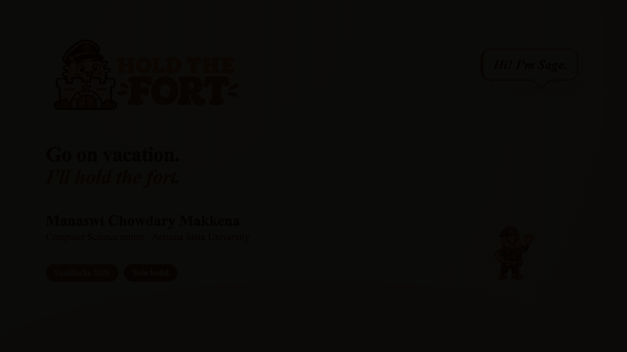
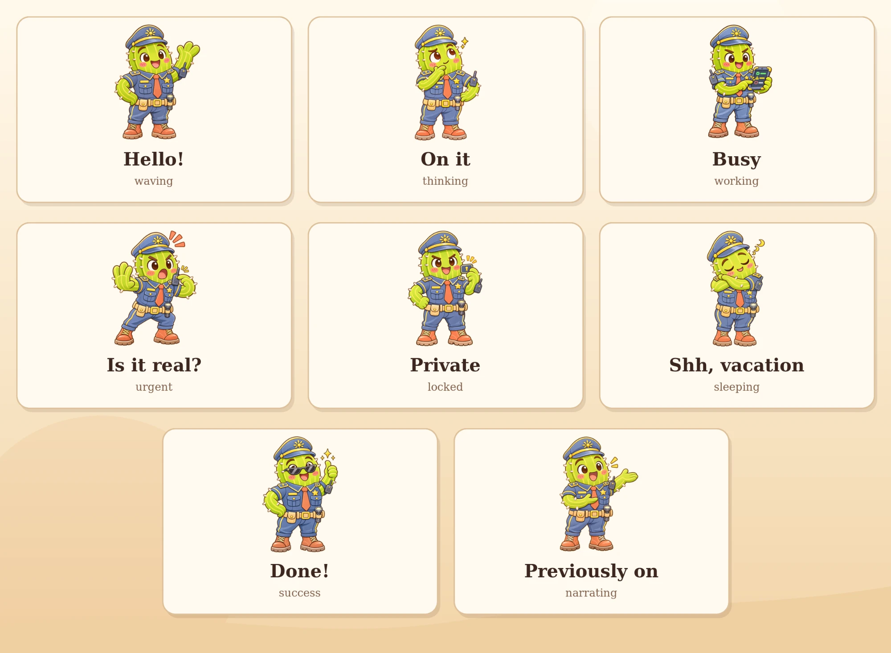
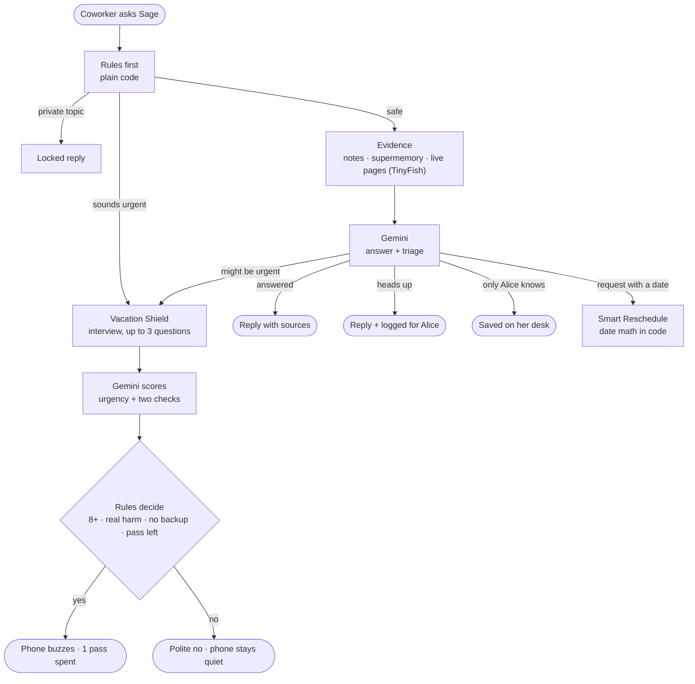
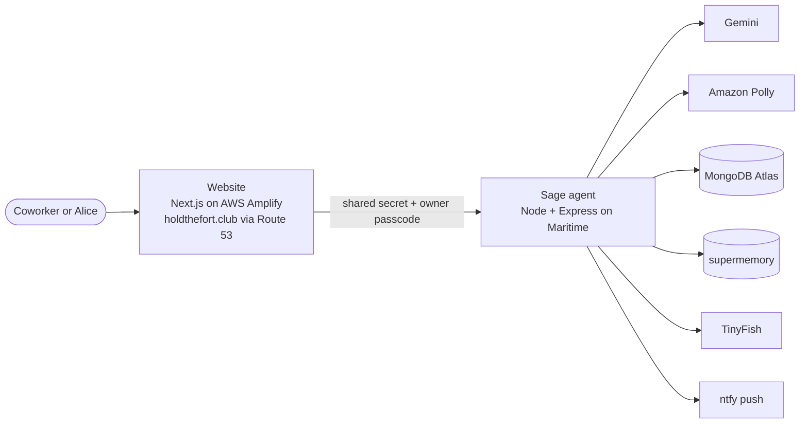

# 🌵 Hold the Fort


**Go on vacation. Sage will hold the fort.** Hold the Fort is a personal away agent. Before you leave, you hand Sage, a cactus security guard, your notes. While you're gone, Sage answers your coworkers with sources, interviews anyone who claims an emergency, moves deadlines to after you're back, keeps private things private, and catches you up in one minute when you return. AI suggests, plain code decides.

Built solo for **SunHacks 2026** (Arizona State University) by [Manaswi Chowdary Makkena](https://manaswichowdary.github.io), CS Senior at ASU.

**[Try it live at holdthefort.club](https://holdthefort.club)** · [Ask Sage as a coworker](https://holdthefort.club/ask/alice) · [Live team board](https://holdthefort.club/board) · [Watch the demo](docs/demo/Hold-the-Fort-Demo.mp4)

## Demo

[](docs/demo/Hold-the-Fort-Demo.mp4)

*Hold-the-Fort Demo, a 2 minute 57 second walkthrough narrated by Sage. [Watch it in full HD](docs/demo/Hold-the-Fort-Demo.mp4).*

The video follows Alice, a student outreach aide, through one vacation: the home page and its little feature videos, night mode, choosing who you are, setting up before she leaves, coworkers asking Sage, a real emergency that reaches her phone, a weak one that doesn't, a deadline moved to after she's back, a Thank You Star, Jen talking to Sage with her mic, the welcome back page, the learning loop, and the "Previously on" recap.

## Meet Sage

<p align="center"></p>

Sage is a cactus security guard who holds the fort while you're away. Sage changes mood with what's happening: waving hello, thinking, busy, checking if an emergency is real, keeping something private, resting while you're on vacation, celebrating, and narrating your "Previously on" recap.



## The Problem

Most people check work messages on vacation. Not because everything is urgent, but because anything *might* be. Coworkers still need answers that only one person has, so the person on the beach keeps their phone close, and one message marked URGENT is enough to ruin a day off.

Hold the Fort gives every coworker a real answer, protects the person who is away, and only lets a true emergency through.

## Try It Yourself

1. Open **[holdthefort.club](https://holdthefort.club)** (or scan the QR code on the home page from your phone).
2. Click **Try it live**, then **Continue as coworker**.
3. Type your name and ask Sage something, for example:
   * `Where are the spring outreach drafts?` answered from Alice's notes, with the source
   * `What's the status of the weekly outreach report?` read live from the team board
   * `What did Alice's performance review say?` locked, never shared
   * `Urgent: the outreach texting tool is down!` starts the Vacation Shield interview
4. Turn on **Voice** to hear Sage answer.

Alice's own view (setup, private notes, welcome back) is behind an owner passcode.

## Features

| Feature | What it does |
|---|---|
| **Quick Answers** | Sage answers only from Alice's shareable notes, live pages and things it has learned, shows every source, and never guesses. Each reply has a "How I did it" trace. |
| **Smart triage** | Every message is sorted: answered, answered and logged for Alice ("for your info"), saved on her desk, locked, or sent to the Vacation Shield. |
| **Vacation Shield** | Anyone who claims an emergency gets interviewed: what breaks, by when, and who else can fix it. Gemini scores the answers, then plain code decides. A push needs 8 out of 10, real harm before she's back, and no backup who can fix it, and it spends one of her shield passes. |
| **Break glass** | With no passes left, a true emergency (9 or 10 out of 10) still gets through. Everything else waits. |
| **Phone alerts** | When the Shield lets something through, Alice's phone buzzes (ntfy) with who needs her and why. |
| **Smart Reschedule** | A request due while she's away moves to the first free slot after she returns (never the return day, at most 2 deadlines a day, no weekends), with a one click calendar invite. |
| **Thank You Stars** | Coworkers who cover for her earn stars on a shared team board. |
| **Catch Me Up** | A live welcome back page, a short note from Sage, and a narrated "Previously on" recap of the week. |
| **Learning loop** | When Alice answers a question on her desk, Sage saves it to supermemory and answers it on its own next time, marked "Learned". |
| **Live pages** | Sage reads watched pages like the team board with TinyFish at question time, and warns when a saved note and a live page disagree. |
| **Locked notes** | Notes marked private never leave the fort. They are never sent to memory or the model. |
| **Voice** | Speak to Sage, and Sage answers in a natural voice (Amazon Polly, Tiffany) that starts in under a second. |
| **Sage the mascot** | A cactus security guard with nine moods (waving, thinking, working, urgent, locked, sleeping, success, narrating, on duty), day and night themes. |

### What can wait, and what reaches Alice

| Can wait | Reaches Alice |
|---|---|
| Printer out of toner, Jen at the front desk can swap it: declined, phone stays quiet | Texting tool down for 3000 students the night before orientation, only Alice has the admin login: 10 out of 10, phone buzzes |
| Purchase order number for new banners: saved on her desk | With zero passes left, only a true 9 or 10 still breaks the glass |
| Huddle moved to room 118: answered and logged for later | |
| "What did her review say?": locked, never shared | |

## How It Works



## Architecture



| Layer | Technology |
|---|---|
| Website | Next.js 15 (App Router), React 19, TypeScript, plain CSS themes, hosted on **AWS Amplify** with the domain on **Route 53** |
| Agent | Node 22, Express, TypeScript, deployed on **Maritime** (`/health`, `/chat`, streaming voice) |
| Understanding and writing | **Gemini** (triage, answers, Shield interviews and scoring, notes and recap) with a model fallback chain |
| Voice | **Amazon Polly** generative voice (Tiffany), streamed to the browser |
| Data | **MongoDB Atlas** (owners, notes, questions, interruptions, deadlines, stars, team board) |
| Memory | **supermemory** (shareable notes and learned answers) |
| Live pages | **TinyFish** (reads the public team board at question time) |
| Phone alerts | **ntfy** |

## Key Decisions

* **AI suggests, rules decide.** Gemini understands messages, writes replies and scores urgency. Privacy, the urgency bar, shield passes, break glass, and every deadline date are plain code in `agent/src/rules.ts`, `schedule.ts` and `brain.ts`, and they are covered by tests.
* **Private notes never leave the fort.** They are never sent to supermemory or to the model. A question that matches one gets a locked reply.
* **Numbers are checked.** Sage's welcome back note is written by Gemini, then a rule rejects it if it contains any number that isn't in the real data, and a plain version is used instead.
* **Locked down by default.** The website and the agent share a secret, Alice's routes need an owner passcode, coworkers only reach the routes they need, and chat, interviews and voice are rate limited per visitor.
* **One voice, no robot fallback.** Sage always speaks as Tiffany. If voice is unavailable, the reply still shows as text.

## Results

* **14 of 14** on the accuracy eval (`npm run eval`): answers, locked topics, urgent messages, desk questions and logged heads ups.
* **11 of 11** rules tests passing (`npm test`): the Shield, break glass, the AI being down, the calendar file, and the keyword rules.

## Run It Locally

You need Node 22 and accounts for the services above (MongoDB Atlas, Gemini, supermemory, TinyFish; AWS Polly and ntfy are optional).

```bash
git clone https://github.com/manaswichowdary/hold-the-fort.git
cd hold-the-fort
cp .env.example .env        # fill in your keys
```

```bash
cd agent && npm install
npm run seed -- --history   # Alice's demo week: notes, team board, questions
npm run dev                 # agent on http://localhost:8787
```

```bash
cd web && npm install
npm run dev                 # website on http://localhost:3000
```

```bash
cd agent
npm test                    # 11 rules tests
npm run eval                # 14 question accuracy eval
```

Locally, with no `AGENT_AUTH` set, the agent stays open for development. In production set the same `AGENT_AUTH` on the agent and the website, and `OWNER_PASSCODE` on the website.

## Deploy

* **Agent on Maritime:** the `Dockerfile` at the repo root builds the agent (port 8080). Set the agent variables from `.env.example` as Maritime secrets.
* **Website on AWS Amplify:** `amplify.yml` builds the `web` folder and passes `AGENT_URL`, `AGENT_AUTH` and `OWNER_PASSCODE` to the server. Set the platform to Web Compute (Next.js SSR).
* **Domain:** a Route 53 hosted zone for `holdthefort.club`, connected in Amplify's Custom domains.

## Project Structure

```
agent/          Sage: Express API, rules, Shield, scheduling, memory, voice, tests and eval
  src/brain.ts      answers, triage, Shield interview, recap, notes
  src/rules.ts      private and urgent rules (plain code)
  src/schedule.ts   deadline math and calendar files
  src/security.ts   shared secret, owner routes, rate limits
  src/speech.ts     streamed voice (Amazon Polly, Gemini fallback)
web/            Website: home, Who are you, setup, ask, phone, welcome back, stars, team board
docs/demo/      Hold-the-Fort Demo video and preview
docs/mascot/    Sage the mascot and moods
Dockerfile      Agent image for Maritime
amplify.yml     Website build for AWS Amplify
```

## Built By

**Manaswi Chowdary Makkena**, CS Senior at Arizona State University · [Portfolio](https://manaswichowdary.github.io) · [GitHub](https://github.com/manaswichowdary)

Built solo for SunHacks 2026.
